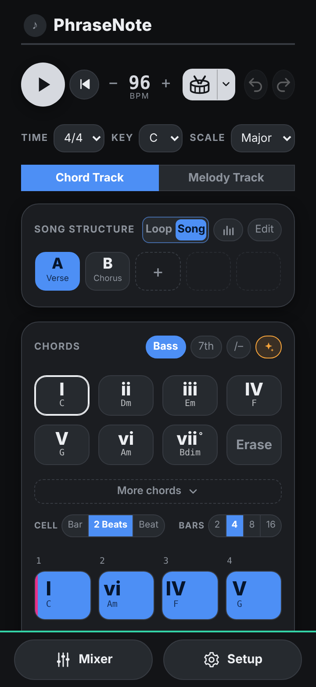
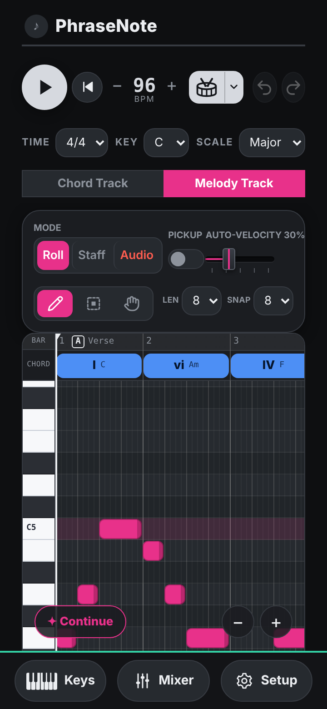
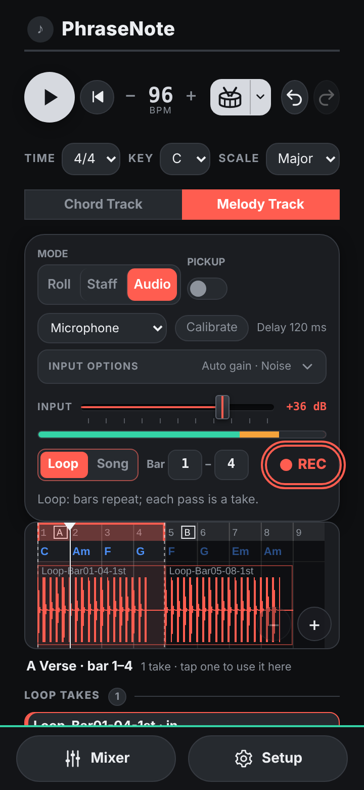

# PhraseNote

**A chord and melody sketching web app for mobile (Android)**

<p align="center">
  
  
  
</p>
<p align="center"><sub>Chord Track · Melody Track (Roll) · Melody Track (Audio)</sub></p>

<p align="center">
  <a href="https://minux22.github.io/PhraseNote/"><b>Open the app</b></a> ·
  User guide: <a href="docs/PhraseNote_UserGuide_EN.pdf">English</a> · <a href="docs/PhraseNote_UserGuide_KO.pdf">한국어</a>
</p>

## Overview / 소개

PhraseNote is a web app for capturing musical ideas on a phone and listening to them right away. Work is organised around two tracks: the **Chord Track**, where the harmony and structure of a song are set, and the **Melody Track**, where a melody is written over them or recorded by singing. Accompaniment, bass, drums and dynamics are generated automatically, and the result can be saved as MIDI and WAV files to continue in a DAW.

PhraseNote는 떠오른 악상을 휴대폰에서 바로 기록하고 들어 볼 수 있도록 만든 웹앱입니다. 작업은 두 개의 트랙으로 이루어집니다. **코드 트랙**에서 곡의 화성 진행과 구조를 정하고, **멜로디 트랙**에서 그 위에 선율을 입력하거나 노래로 녹음합니다. 반주, 베이스, 드럼, 강약은 자동으로 만들어지며, 결과물은 MIDI와 WAV 파일로 저장하여 DAW에서 이어서 작업할 수 있습니다.

## Features / 주요 기능

| Feature | Description | 설명 |
|---|---|---|
| Chord progressions | Random chord progressions in the key | 현재 조에 맞는 코드 진행 랜덤 생성 |
| Chords from a melody | Chord suggestions and a key estimate for a melody written first | 먼저 쓴 멜로디에 어울리는 코드 추천과 조 추정 |
| Song structure | Sections and slots, a song overview, and next-section ideas by role (Intro to Outro) | 섹션 · 슬롯 구성, 곡 전체 보기, 곡의 단계에 맞춘 다음 섹션 제안 |
| Key and tempo per slot | A key change or a tempo change for a single slot | 슬롯 단위의 전조와 템포 변경 |
| Accompaniment and drums | Accompaniment styles, bass lines and genre drum patterns, with a custom pattern editor | 반주 스타일, 베이스 라인, 장르별 드럼 패턴과 사용자 패턴 편집 |
| Melody input | Piano roll, staff, on-screen keyboard, quantize, and melody continuation ideas | 피아노롤, 오선보, 화면 건반, 퀀타이즈, 멜로디 이어 쓰기 제안 |
| Singing | Loop or song recording, takes per section, and clip editing (split, delete, move, trim) | 루프 · 곡 단위 녹음, 섹션별 테이크 선택, 클립 편집(분할 · 삭제 · 이동 · 길이 조절) |
| Mixer | Level, mute and solo per part, reverb, master and a level meter | 파트별 음량 · 뮤트 · 솔로, 리버브, 마스터, 레벨 미터 |
| Saving | One file with the project, MIDI (with tempo and key changes) and WAV files | 프로젝트, MIDI(템포 · 조 변경 포함), WAV 파일을 한 번에 저장 |

## Requirements / 사용 환경

- An Android phone with Samsung Internet or Chrome. The screen layout is designed for phones.
- Recording requires microphone permission. Wired earphones are recommended, as Bluetooth earphones add too much delay.
- 삼성 인터넷 또는 Chrome이 설치된 Android 휴대폰에서 사용하십시오. 화면 구성은 휴대폰을 기준으로 설계되었습니다.
- 녹음에는 마이크 권한이 필요합니다. 블루투스 이어폰은 지연이 커서 녹음에 적합하지 않으므로 유선 이어폰 사용을 권장합니다.

## Sounds / 기본 음원

On first launch, PhraseNote downloads **GeneralUser GS v2.0.3** by S. Christian Collins (about 31 MB) once and keeps it on the device. Other .sf2 files can be added in Setup.

처음 실행할 때 S. Christian Collins의 **GeneralUser GS v2.0.3**(약 31MB)을 한 번 내려받아 기기에 보관합니다. 다른 .sf2 파일은 Setup에서 추가할 수 있습니다.

## For developers / 개발 정보

| Path | Description |
|---|---|
| `src/chord-sketch.html` | **The single source of the app** (one self-contained HTML file). Edit this file. |
| `index.html`, `sw.js` | Generated by `tools/build.py` for GitHub Pages. Do not edit by hand. |
| `manifest.webmanifest`, `icons/` | PWA install data. |
| `tests/` | Node regression tests for the pure `Core` logic. |
| `docs/` | User guides (PDF) and the screenshots shown above (`docs/img/`). |
| `sf/` | The built-in SoundFont (GeneralUser GS) and its license. |
| `tools/guide/` | Scripts that build the user guides. |

```sh
python3 tools/build.py   # regenerate index.html and stamp the version into sw.js
sh tests/run.sh          # run the regression tests
```

For every release, update the version in the `PhraseNote vX.Y.Z` footer line of `src/chord-sketch.html`. The service worker cache name follows it, so installed apps receive the update.

## License / 라이선스

Copyright (C) 2026 Min

PhraseNote is free software: you can redistribute it and/or modify it under the terms of the [GNU General Public License](LICENSE) as published by the Free Software Foundation, either version 3 of the License, or (at your option) any later version. It is distributed in the hope that it will be useful, but WITHOUT ANY WARRANTY; without even the implied warranty of MERCHANTABILITY or FITNESS FOR A PARTICULAR PURPOSE.

GeneralUser GS is distributed under its own license; please see [`sf/LICENSE.txt`](sf/LICENSE.txt) and https://www.schristiancollins.com.

PhraseNote는 [GNU 일반 공중 사용 허가서(GPL) 버전 3](LICENSE) 또는 그 이후 버전에 따라 배포됩니다. 누구나 자유롭게 사용 · 수정 · 재배포할 수 있으나, 수정한 버전을 배포할 때에는 같은 라이선스로 소스 코드를 공개해야 합니다. 이 프로그램은 어떠한 보증도 없이 제공됩니다. GeneralUser GS는 별도의 라이선스를 따르므로 [`sf/LICENSE.txt`](sf/LICENSE.txt)와 https://www.schristiancollins.com 을 참조하십시오.

## Installing as an app / 앱으로 설치하기

Open the app address once in the browser and add it to the home screen. It will then open full screen like an installed app and can be used offline after the first visit.

브라우저에서 앱 주소를 한 번 연 뒤 홈 화면에 추가하십시오. 이후에는 설치한 앱처럼 전체 화면으로 실행되며, 최초 실행 이후에는 인터넷 연결 없이도 사용할 수 있습니다.

**Samsung Internet / 삼성 인터넷**

1. Open https://minux22.github.io/PhraseNote/
2. Menu (☰, bottom right) → **Add page to** → **Home screen** → **Add**.
   메뉴(☰, 오른쪽 아래) → **페이지 추가** → **홈 화면** → **추가**를 선택합니다.
   If an install icon appears in the address bar, it may be used instead. 주소창에 설치 아이콘이 표시되면 해당 아이콘으로도 설치할 수 있습니다.

**Chrome**

1. Open https://minux22.github.io/PhraseNote/
2. Menu (⋮, top right) → **Install app** or **Add to Home screen** (the name varies by version) → **Install**.
   메뉴(⋮, 오른쪽 위) → **앱 설치** 또는 **홈 화면에 추가**(버전에 따라 명칭이 다릅니다) → **설치**를 선택합니다.

**Updates / 업데이트**

When a new version is published, close the app completely and open it twice: the first launch downloads the update and the second applies it. The current version is shown at the bottom of the app.

새 버전이 배포되면 앱을 완전히 종료한 뒤 두 번 다시 실행하십시오. 첫 번째 실행에서 새 버전을 내려받고, 두 번째 실행에서 적용됩니다. 현재 버전은 앱 화면 하단에 표시됩니다.

**Microphone / 마이크 권한**

Please allow microphone access when asked. If it was refused, it can be allowed again in the browser's site settings.

녹음하려면 마이크 권한 요청을 허용하십시오. 거부한 경우 브라우저의 사이트 설정에서 다시 허용할 수 있습니다.
